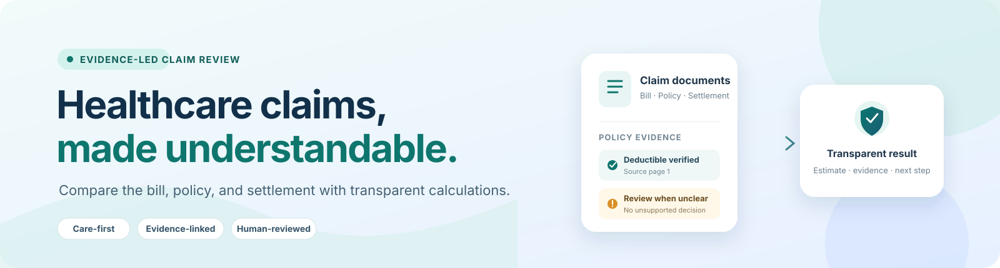

<div align="center">
  
  <h1>MediGuard AI</h1>
  <p><strong>Make health insurance settlements easier to understand.</strong></p>
  <p>Upload a hospital bill, policy, and settlement letter. Get a transparent estimate, see how deductions compare with policy evidence, and know when a human reviewer needs to step in.</p>
  <p>
    <a href="https://mediguard-ai-demo.onrender.com/">Open the live demo</a> ·
    <a href="#screenshots">View screenshots</a> ·
    <a href="docs/06_EVALUATION_RESULTS.md">Read the evaluation</a>
  </p>
</div>

<p align="center">
  <a href="https://github.com/pratapasaivarun/MediGuard-AI/actions/workflows/tests.yml"></a>
  
  
  
  <a href="LICENSE"></a>
</p>

> **Demo safety:** This college prototype uses fictional sample documents. Never upload real patient, insurance, or personally identifying information. It is not an insurer decision system or legal advice.

## The problem

Insurance settlement letters can be hard to compare with a hospital bill and the policy that governs it. MediGuard AI brings those documents together and explains, line by line, where an insurer's deductions appear to match the policy, where they may differ, and where the available evidence is not enough to decide.

## What you can do

| Step | What the app shows |
|---|---|
| Add claim documents | Upload a hospital bill, policy PDF, and settlement letter. Scanned pages can use OCR. |
| Review policy terms | Extract terms with page evidence; a reviewer can correct and confirm them. |
| Calculate an estimate | Apply transparent Python rules for covered charges, exclusions, deductibles, co-pay, and limits. |
| Compare the settlement | See the expected and actual patient share, deduction categories, policy evidence, and possible difference. |
| Handle uncertainty safely | Route missing, ambiguous, or unconfirmed information to Manual Review instead of claiming certainty. |

## Screenshots

These screens come from the running app and use fictional sample claims.

<p align="center">
  
  
</p>
<p align="center">
  
  
</p>
<p align="center">
  
  
</p>

More: [appeal draft](docs/images/04-appeal-download.png) · [screenshot capture guide](docs/08_SCREENSHOT_CAPTURE.md).

## How it works

<p align="center">
  
</p>

**Flow:** bill, policy, and settlement → extraction and page evidence → deterministic Python rules → settlement comparison → explanation and report → claimant or reviewer screens.

Python controls every amount and status. LangGraph coordinates the document, policy, decision, and output stages. The optional local Ollama model can explain completed results; it does not decide the outcome.

## Evaluation

The current benchmark contains **30 synthetic cases** with hand-labeled results in [`samples/evaluation_cases/ground_truth.json`](samples/evaluation_cases/ground_truth.json). These measurements show behavior on the committed fictional fixtures, not accuracy on real insurance claims. Results are written to `evaluation/latest/results.json`; reproduce them with `python.exe -m evaluation.run_all` on Windows or `python -m evaluation.run_all` on macOS/Linux.

| Check | Result |
|---|---:|
| Comparison decisions | 30/30 |
| Intended provisional route | 30/30 |
| Text-bill line-item description and amount matches | 28/28 |
| Policy terms extracted from source PDFs | 210/210 |
| Adversarial cases with safe result shown | 10/10 |
| Category prototype challenge | 72/73; prototype is not connected to app runtime |

One case is deliberately held for review until an exclusion is confirmed. The app does not show a provisional amount for that case. See the [full scorecard and limits](docs/06_EVALUATION_RESULTS.md).

## Try the demo

Open the [live MediGuard AI demo](https://mediguard-ai-demo.onrender.com/). Use only the bundled fictional examples. The demo stores data in temporary SQLite storage, so accounts, claims, and uploads can be erased when the service restarts or redeploys.

### Run locally on Windows

Python 3.13 is the verified runtime. From PowerShell:

```powershell
git clone https://github.com/pratapasaivarun/MediGuard-AI.git
Set-Location MediGuard-AI
py -3.13 -m venv .venv
.\.venv\Scripts\python.exe -m pip install -r requirements.txt
.\.venv\Scripts\python.exe run_demo.py
```

The local demo opens at <http://127.0.0.1:8506>. Tesseract is optional for scanned-page OCR. Ollama is optional for local explanations; the app still calculates amounts and statuses without it. See [local run instructions](docs/03_RUNNING_THE_DEMO.md) for reviewer setup and other operating systems.

To start the regular app instead of the sample launcher, use `python -m streamlit run app.py --server.port 8501`; it opens at <http://127.0.0.1:8501>.

## Technology

| Area | Tools |
|---|---|
| App | Python 3.13, Streamlit |
| Workflow | LangGraph |
| Document handling | PyMuPDF, Tesseract OCR, ReportLab |
| Policy search | ChromaDB, BGE-small embeddings (loaded only when search is requested) |
| Storage | SQLite for the prototype demo |
| Optional explanations | Ollama; Python remains the source of every amount and status |

## Scope and limitations

- Synthetic examples only; real claims and patient data have not been evaluated.
- A reviewer must verify extracted policy terms and source pages before relying on a result.
- The category prototype is an offline benchmark only; category suggestions are not integrated into the app.
- Render uses temporary SQLite storage; this hosted demo is not configured for durable claim data.
- Optional local language-model output can vary. Amounts and statuses remain deterministic.

## Project docs

- [Overview](docs/01_OVERVIEW.md) · [Architecture](docs/02_ARCHITECTURE.md) · [Math examples](docs/04_MATH_GOLDEN_CASES.md)
- [LLM safety](docs/05_LLM_SAFETY.md) · [Evaluation results](docs/06_EVALUATION_RESULTS.md) · [Known limitations](docs/07_LIMITATIONS.md)
- [Reproduce screenshots](docs/08_SCREENSHOT_CAPTURE.md) · [Project report](docs/PROJECT_REPORT.md)

## License

MIT. See [LICENSE](LICENSE).

<p align="center"><sub>Built as an academic prototype to make claim calculations easier to inspect and discuss.</sub></p>
